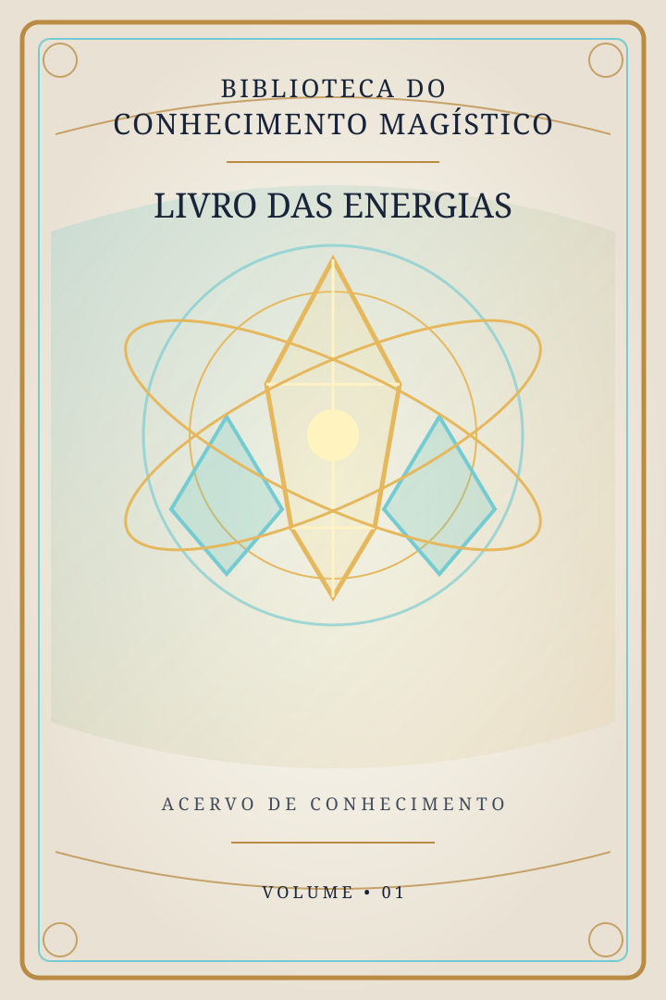
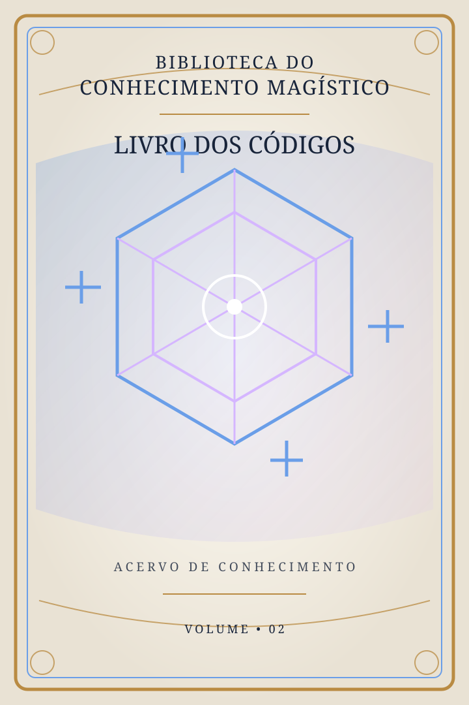
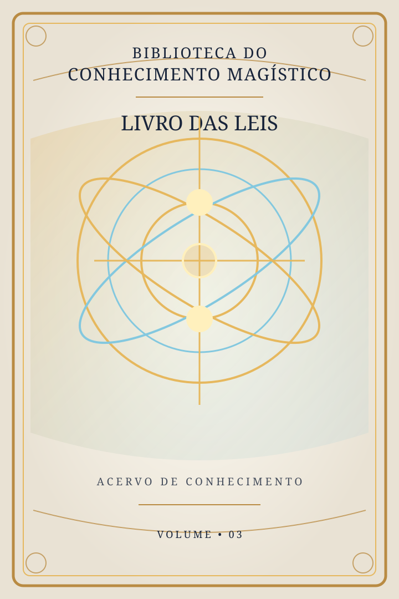
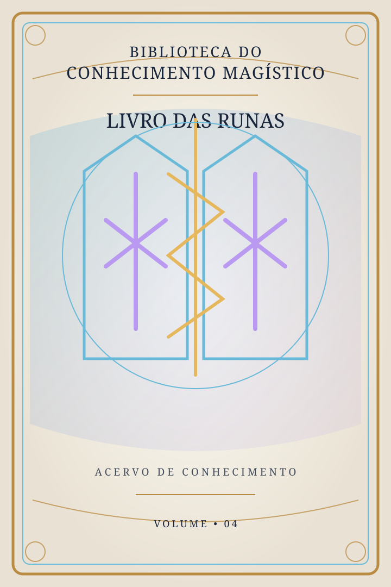
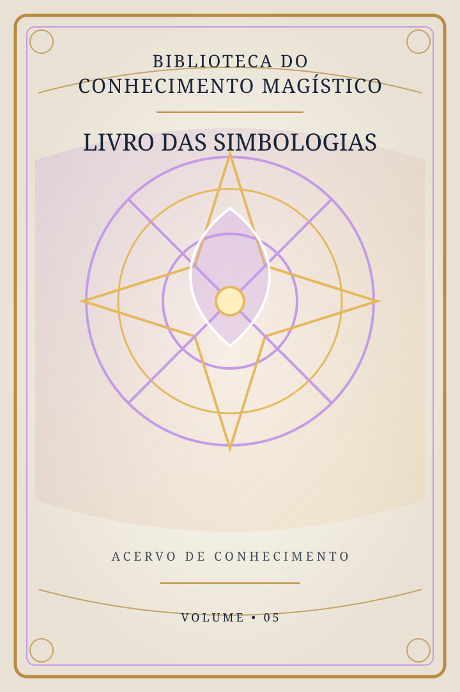
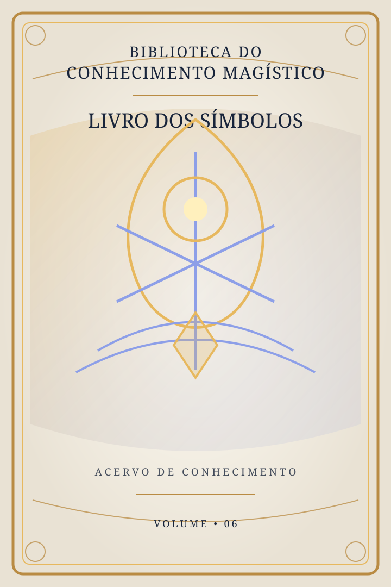

<header class="library-hero">
  
ACERVO DIGITAL • CONSULTA PÚBLICA

  <h1>Biblioteca do Conhecimento Magístico</h1>
  
Seis livros. Um acervo em constante construção. Conhecimento organizado para pesquisar, consultar e explorar.

  
Escolha um livro para entrar em seu catálogo. Novos registros serão acrescentados gradualmente.

</header>

<section class="library-books">
  <a class="book-card book-energias" href="livros/energias/">
    
    <strong>Livro I — Energias</strong><small>Catálogo de energias cristalizadas</small>
  </a>
  <a class="book-card book-codigos" href="livros/codigos/">
    
    <strong>Livro II — Códigos</strong><small>Catálogo de códigos</small>
  </a>
  <a class="book-card book-leis" href="livros/leis/">
    
    <strong>Livro III — Leis</strong><small>Catálogo de leis e princípios</small>
  </a>
  <a class="book-card book-runas" href="livros/runas/">
    
    <strong>Livro IV — Runas</strong><small>Catálogo de runas</small>
  </a>
  <a class="book-card book-simbologias" href="livros/simbologias/">
    
    <strong>Livro V — Simbologias</strong><small>Catálogo de sistemas simbólicos</small>
  </a>
  <a class="book-card book-simbolos" href="livros/simbolos/">
    
    <strong>Livro VI — Símbolos</strong><small>Catálogo de símbolos individuais</small>
  </a>
</section>

<section class="library-principles">
  <h2>Como o acervo é organizado</h2>
  
Os registros serão apresentados em ordem alfabética e poderão ser encontrados pela busca geral. Cada item será analisado antes da inclusão para identificar sua habilidade principal e sua área predominante.

  

    
<strong>Corpo</strong>Aspectos físicos, materiais e estruturais.

    
<strong>Mente</strong>Pensamentos, emoções, sentimentos e processos mentais.

    
<strong>Espírito</strong>Aspectos espirituais e energéticos segundo a classificação do catálogo.

  

  
Um registro poderá ter áreas secundárias, mas sempre terá uma área predominante. A classificação será baseada no conteúdo fornecido e revisada antes da publicação.

</section>

