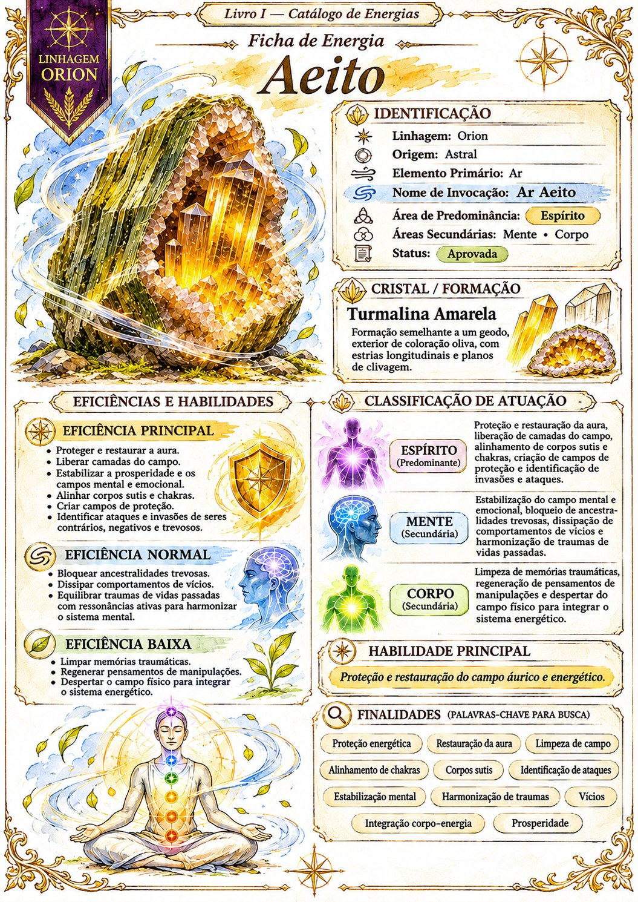

# Aeito

Índice de pesquisa: Ar Aeito; proteção energética; proteger aura; restauração da aura; restaurar campo áurico; campo energético; liberar camadas do campo; estabilização da prosperidade; equilíbrio mental; equilíbrio emocional; alinhamento de corpos sutis; alinhamento de chakras; campo de proteção; campos protetores; identificação de ataques; identificação de invasões espirituais; seres contrários; seres negativos; seres trevosos; ancestralidades trevosas; bloqueio de ancestralidades; dissipação de vícios; comportamentos de vícios; traumas de vidas passadas; ressonâncias ativas; harmonização do sistema mental; limpeza de memórias traumáticas; regeneração de pensamentos de manipulação; despertar do campo físico; integração do sistema energético; Espírito; Mente; Corpo; turmalina amarela; cristal; energia astral; elemento Ar; linhagem Orion.

