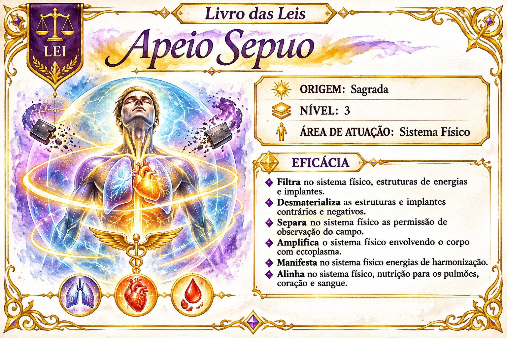

# Apeio Sepuo

Índice de pesquisa: Apeio Sepuo; Lei Apeio Sepuo; leis sagradas; nível 3; sistema físico; filtragem energética; estruturas de energia; implantes energéticos; desmaterialização de estruturas negativas; estruturas contrárias; implantes negativos; permissões de observação do campo; separação de permissões; amplificação do sistema físico; ectoplasma; envolvimento do corpo; energias de harmonização; nutrição dos pulmões; coração; sangue; alinhamento físico.

