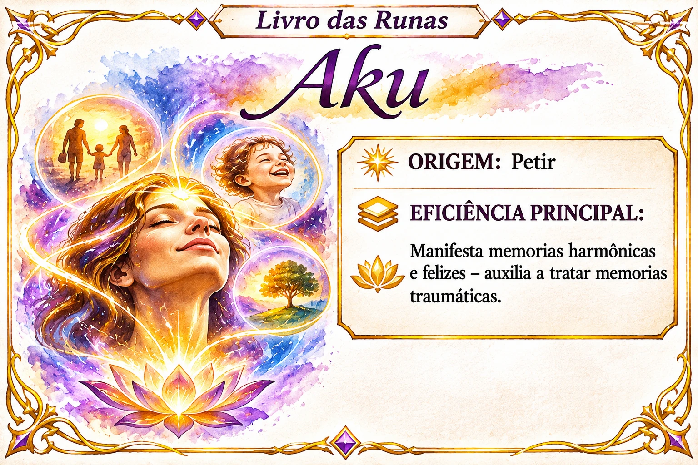

# Aku

Índice de pesquisa: Aku; runa Aku; runas; origem Petir; memórias harmônicas; memórias felizes; manifestação de memórias positivas; tratamento de memórias traumáticas; memórias traumáticas; harmonização da memória; lembranças felizes; lembranças positivas; memória emocional.

