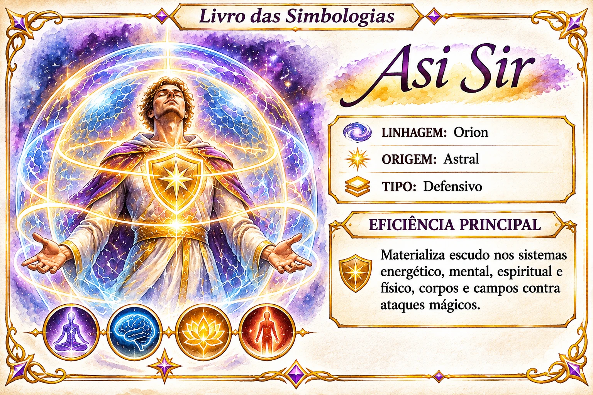

# Asi Sir

Índice de pesquisa: Asi Sir; simbologia Asi Sir; simbologias Orion; linhagem Orion; origem Astral; simbologia defensiva; escudo energético; escudo mental; escudo espiritual; escudo físico; proteção dos sistemas energético mental espiritual e físico; proteção de corpos e campos; ataques mágicos; defesa mágica; materialização de escudo.

