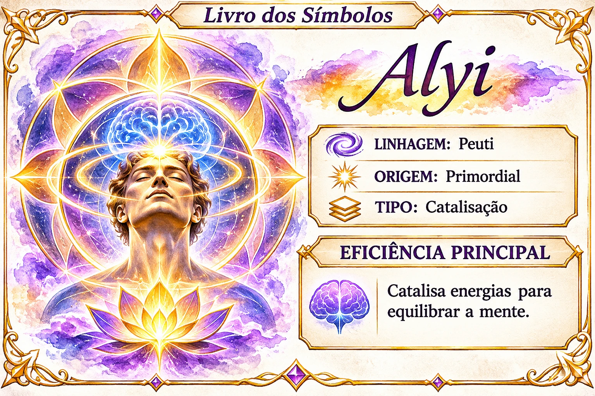

# Alyi

Índice de pesquisa: Alyi; símbolo Alyi; símbolos Peuti; linhagem Peuti; origem Primordial; catalisação; catalisação energética; catalisar energias; equilíbrio mental; harmonização da mente; símbolo de equilíbrio da mente.

