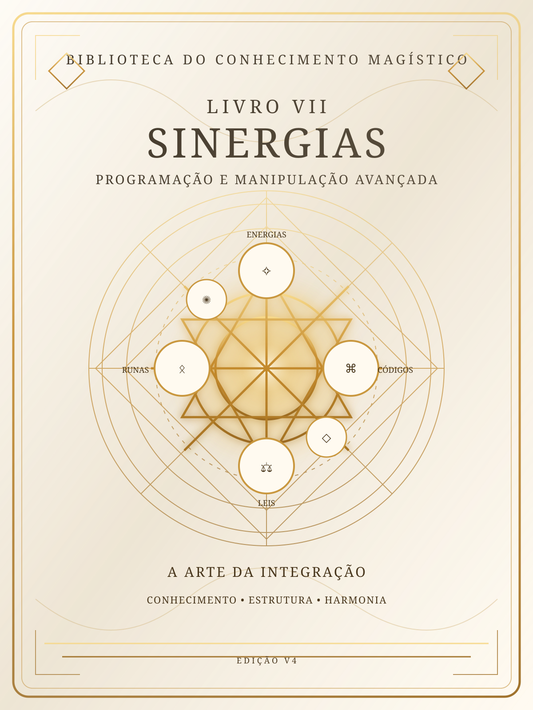

# Livro VII — Sinergias
## Programação e Manipulação Avançada

**Biblioteca do Conhecimento Magístico · Edição v4**

O Livro VII é o volume de integração e aplicação avançada da Biblioteca do Conhecimento Magístico. Ele reúne os conhecimentos catalogados nos seis livros anteriores e propõe formas estruturadas de relacionar seus componentes em programações e sinergias com objetivos definidos.

A proposta central é sair da consulta isolada de cada registro e estudar como diferentes componentes podem ocupar funções complementares dentro de uma mesma programação — sem alterar o significado original das fichas, sem atribuir capacidades que não estejam documentadas e sem adicionar elementos apenas para aumentar a quantidade.

## Objetivo do livro

Oferecer um método organizado para estudar, construir, revisar e ampliar combinações entre:

- **Energias** — propriedades e habilidades descritas nas fichas do catálogo.
- **Códigos** — funções de programação e atuação informacional conforme os registros.
- **Leis** — princípios e operações descritos no respectivo livro.
- **Runas** — estruturas rúnicas e suas funções documentadas.
- **Simbologias** — conjuntos simbólicos e aplicações registradas.
- **Símbolos** — representações e funções catalogadas.

O resultado esperado é um repertório progressivo de programações coerentes, justificadas e revisáveis.

## Principais aplicações contempladas

- Limpeza e purificação energética.
- Tratamento energético, recomposição e reequilíbrio.
- Harmonização de ambientes, campos e vínculos, respeitando autonomia e consentimento.
- Restauração, regeneração e integração energética.
- Proteção, blindagem e defesa não ofensiva.
- Estruturação, estabilização e ancoragem.
- Fortalecimento, desenvolvimento e expansão de potenciais.
- Evolução e integração de práticas.

## O que você encontra neste volume

1. **Sinergias estruturadas:** combinações em que a contribuição de cada componente é explicada.
2. **Programações energéticas:** sequências de evocação, comandos e organização da intenção.
3. **Protocolos completos:** preparação, execução, emanação e encerramento.
4. **Matriz de compatibilidade:** afinidades, sobreposições, redundâncias e possíveis conflitos.
5. **Análises críticas:** justificativas, limitações, lacunas documentais e pontos ainda hipotéticos.
6. **Modelos expansíveis:** padrão editorial para desenvolver e revisar novas propostas.

## Estrutura da primeira edição

A primeira edição reúne **seis propostas de programação**:

| Código | Programação | Estado |
|---|---|---|
| VII-01 | Proteção, contenção e estabilização integral | Piloto |
| VII-02 | Limpeza, regeneração e sincronização energética | Piloto |
| VII-03 | Harmonização mental, sensorial e da personalidade | Piloto |
| VII-04 | Memórias positivas e estabilidade emocional | Piloto |
| VII-05 | Decodificação, purificação e estruturação energética | Experimental |
| VII-06 | Harmonização energética associada ao corpo | Experimental |

A edição também apresenta uma matriz de compatibilidade, uma lista de fichas que precisam de revisão e um padrão para a criação de novas programações.

[**Acessar as sinergias e programações completas do Livro VII**](./index)

## Método de análise e rigor editorial

Cada proposta separa claramente três níveis:

- **Conteúdo da ficha:** o que está declarado no registro original.
- **Interpretação funcional:** a função que o componente pode ocupar quando relacionado a outros registros.
- **Hipótese de programação:** a sequência, o comando e as etapas sugeridas para estudo.

As combinações não são consideradas automaticamente eficazes pela simples soma de componentes. Redundâncias precisam de justificativa; possíveis conflitos e lacunas devem ser registrados; e nenhuma habilidade pode ser atribuída a um componente sem apoio na ficha correspondente.

## Integração com a Biblioteca

Este volume complementa os seis livros que formam a base documental da Biblioteca. As fichas originais permanecem como referência primária; o Livro VII conecta seus conteúdos, mas não substitui nem modifica os registros de origem.

## Limites de uso

O Livro VII tem finalidade documental, conceitual e prática dentro do modelo interno da Biblioteca. As propostas não constituem comprovação científica nem substituem cuidados médicos, psicológicos ou outros serviços profissionais.

Este volume é dedicado exclusivamente a aplicações construtivas e não ofensivas. Não contempla ataques, agressões, maldições, sabotagem, coerção ou interferência não consentida sobre pessoas ou seres.

---

**Princípio do Livro VII:** uma sinergia só merece ser mantida quando a função de cada componente pode ser explicada, sua contribuição é pertinente ao objetivo e seus limites estão claramente identificados.
